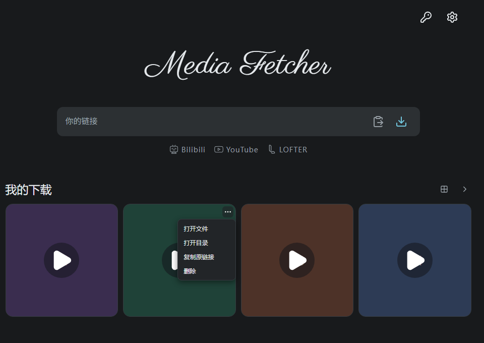
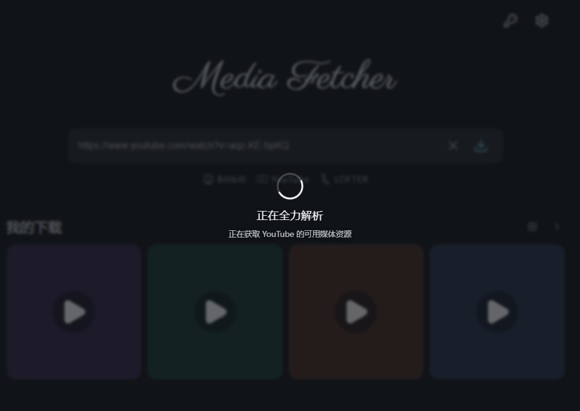
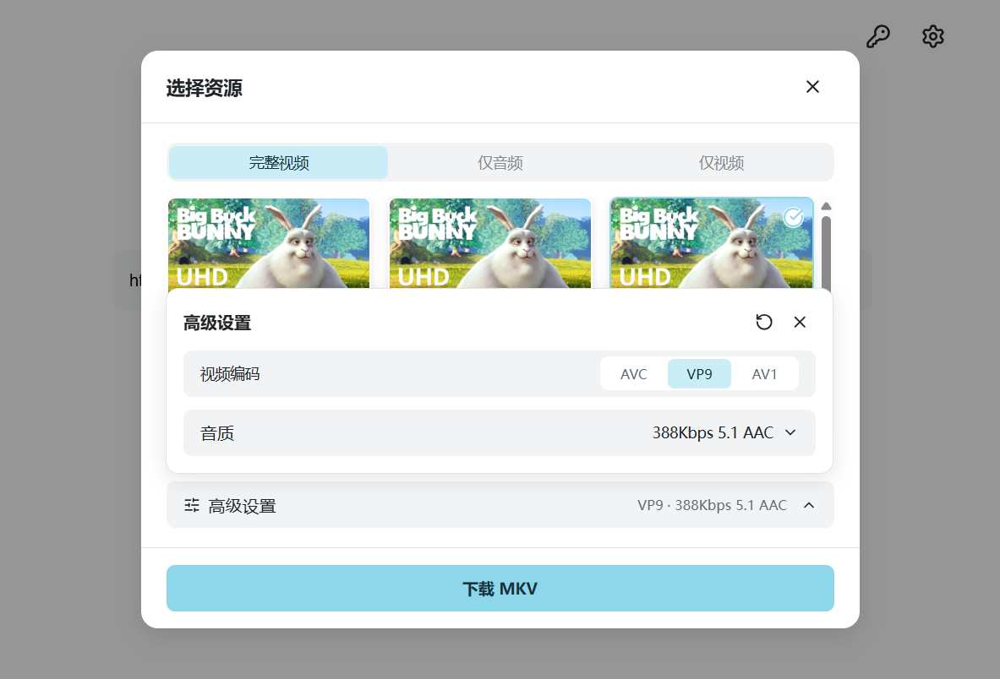
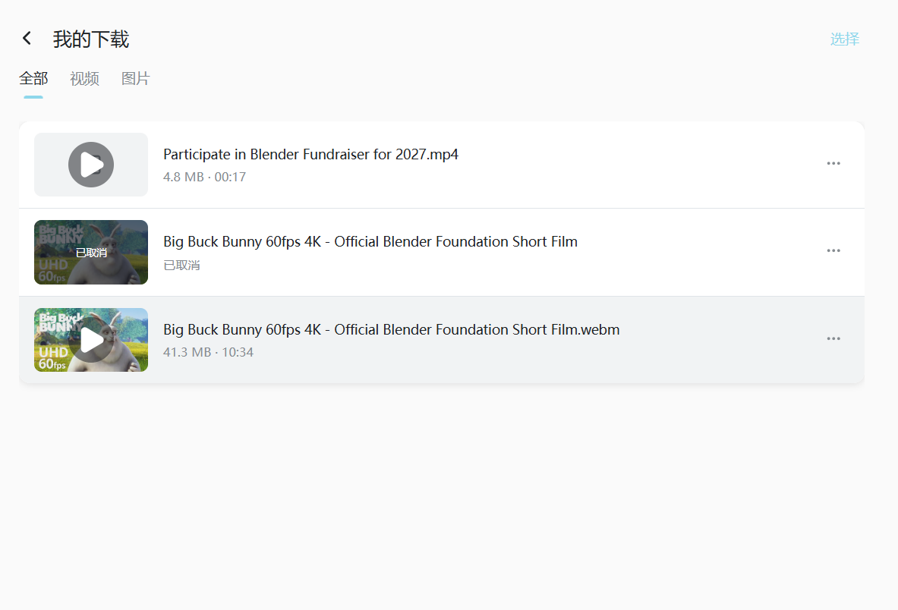

# Media Fetcher

Media Fetcher 是一款基于 **Go Core + MyGo (v0.10.0) + Vue 3** 构建的本地桌面媒体解析与下载工具。桌面端与 CLI 共用同一套站点解析、凭证隔离、HTTP 分块下载与 FFmpeg 无损封装核心，无需独立 HTTP 服务进程。

> **平台状态说明**：当前项目仅在 **Windows (amd64)** 上完成了完整的桌面端实机验收与打包构建。底层框架 MyGo v0.10.0 支持 macOS、Linux、Android 与 iOS，但**本项目尚未完成这些平台的适配与验证**。

---

## 应用截图

> 以下截图均来自当前版本界面：资源选择与下载管理为真实打包 Windows 桌面程序实测画面（测试样片采用 Blender Foundation 官方开源 CC 媒体），首页与解析遮罩展示了暗色主题下的交互状态。

| 首页与快捷下载菜单（Dark） | 首页慢速解析等待遮罩（Dark） |
| --- | --- |
|  |  |

| 资源选择与高级设置（Light · 实机） | 详细下载管理与历史列表（Light · 实机） |
| --- | --- |
|  |  |

---

## 核心特性

- **多平台解析与分享文案识别**：直接粘贴完整链接或包含链接的中文分享文案，自动识别支持站点并过滤仿冒域名与追踪参数。
- **多容器无损封装（MP4 / WebM / MKV）**：
  - 完整视频与单视频轨道均严格使用 FFmpeg `-c copy` **无损封装、零静默转码**，并在原子发布前通过 `ffprobe` 校验容器格式、时长、轨道数与源轨编码一致性：
    - `AVC / HEVC / AV1` + `AAC / AC-3 / E-AC-3 / FLAC` → **MP4**（启用 `+faststart`）
    - `VP9 / VP8 / AV1` + `Opus / Vorbis` → **WebM**
    - 跨生态组合（如 `VP9 + AAC`、`AVC + Opus`）→ **MKV**
- **原始音频输出**：支持 **原始（Original）/ M4A / MP3** 三种音频输出模式。原始模式通过 `ffprobe` 探测真实编码并按需无损重封装（`AAC → .m4a`、`Opus → .opus`、`FLAC → .flac`、`E-AC-3 / AC-3 / MP3 → 对应格式`），不二次有损编码；仅在显式选择 `MP3` 或非 AAC 音轨转 `M4A` 时执行转码。
- **稳健的 Go 下载核心**：
  - 支持顺序分块 HTTP Range 下载（默认 `10 MiB` 分块）、精确偏移写入（`WriteAt` 杜绝重试字节重复）、严格 `206` 与 `Content-Range` 校验、有限指数退避重试、独占临时文件与断电安全原子发布。
  - YouTube 在桌面端启用 **90 秒纯内存短 TTL 解析快照**（不落盘、校验签名 URL `expire`、退出账号/关闭弹窗/切换资源即时失效、遇拒单次回退重新解析），大幅缩短点击下载到开始传输的等待时间；Bilibili 与 LOFTER 保持每次下载前重新获取地址的原有策略。
- **现代桌面下载管理体验**：
  - 提供首页「我的下载」快捷图库、侧滑快捷抽屉与独立「详细下载管理页」，支持按类型筛选、单任务进度/取消/重试、自定义下载目录与同名自动避让。
  - 统一互斥的「更多操作」菜单（支持外部点击、Escape、滚动、切换页签自动关闭）、适配 Light / Dark 主题的细长无箭头滚动条，以及延迟 `500ms` 触发的首页解析等待遮罩（避免快速解析闪烁）。
  - 历史记录保留原始媒体链接、实际文件大小与媒体时长；删除支持「仅移除记录」或经文件身份核验后安全移至 Windows 回收站。
- **Windows 代理路径统一**：Go HTTP 客户端与外部 `yt-dlp` 采用一致的代理优先级：**环境变量代理（`HTTPS_PROXY` / `HTTP_PROXY` / `ALL_PROXY` / `NO_PROXY`）→ Windows 系统代理（只读 `Internet Settings` 并遵守 `ProxyOverride` 绕过规则）→ 直连（兼容 TUN 虚拟网卡模式）**，不硬编码本地代理端口，也不修改系统全局网络设置。

---

## 支持站点与边界

| 站点 | 支持范围 | 限制说明 |
| --- | --- | --- |
| **YouTube** | 公开单视频（`youtube.com/watch?v=...`、`youtu.be/...`、`m.youtube.com/...`）与竖屏 Shorts（`/shorts/...`）；独立 HTTPS 视频轨（AVC / VP9 / AV1、按短边归档竖屏画质、区分帧率与 HDR/SDR）与独立音轨（AAC / Opus） | 仅支持匿名公开内容；不支持账号登录、私有/会员/年龄限制视频、DRM、直播/预告流、HLS/DASH Manifest 协议流、播放列表或频道批量下载 |
| **Bilibili** | 普通 BV 视频、分 P、番剧 EP 单集与 SS 剧集选择；匿名解析与本机扫码授权；支持实际返回的 AVC / HEVC / AV1、HDR / 杜比视界与 AAC / Hi-Res FLAC / Dolby 音轨 | 短链请先展开为完整链接；仅支持当前账号实际可访问的 DASH 资源，不支持 DRM、试看突破或批量下载 |
| **LOFTER** | 匿名解析公开图片与图文帖子，支持缩略图预览与多选下载 | 仅支持公开可访问帖子 |

> **分工明确**：对于 YouTube，外部 `yt-dlp` **仅用于元数据与可用轨道 JSON 提取（`--skip-download --dump-single-json`）**，所有媒体文件的 HTTP 下载、分块 Range 重试、进度汇报与 FFmpeg 封装均由 Media Fetcher 自有 Go Core 完成。

---

## 下载与安装（Windows）

从仓库的 **GitHub Releases** 页面获取最新 Windows (amd64) 构建产物：

- **安装包**：`media-fetcher-setup-<version>-amd64.exe`（NSIS 安装向导）
- **便携版**：`media-fetcher-<version>-windows-amd64-portable.zip`（解压后直接运行 `media-fetcher.exe`）
- **完整性校验**：`SHA256SUMS.txt`（下载后可在 PowerShell 中运行 `Get-FileHash <文件名> -Algorithm SHA256` 核对）

> **当前发布限制说明**：
> - Windows 构建产物暂未配置代码签名证书，首次运行可能触发 Windows SmartScreen 提示，请务必通过 `SHA256SUMS.txt` 核对文件哈希。
> - 暂未内置应用自动更新与外部组件一键下载器；所需外部组件请按下方说明手动配置。

---

## 外部组件依赖

为遵守开源许可与安全边界，**本仓库与发布包均不包含以下第三方二进制**，需在本机准备：

| 组件 | 用途 | 适用平台 | 发现位置与配置方式 |
| --- | --- | --- | --- |
| **FFmpeg & ffprobe** | 完整视频无损封装（MP4 / WebM / MKV）、单轨封装、MP3/M4A 转码（需含 `libmp3lame`）、封装校验与时长读取 | 全站点 | 加入系统 `PATH`（或置于 `C:\ffmpeg\bin` / `C:\Program Files\ffmpeg\bin`） |
| **yt-dlp** | **仅用于 YouTube 元数据与轨道解析**，不参与媒体下载 | 仅 YouTube | 按优先级自动发现：① 程序同级 `tools/` 或 `bin/`；② `%APPDATA%\media-fetcher\tools\yt-dlp.exe`（同时支持官方目录版 `tools\yt-dlp\yt-dlp.exe`）；③ 环境变量 `MEDIA_FETCHER_YTDLP_PATH`；④ 系统 `PATH` |
| **JavaScript 运行时** | 供 `yt-dlp` 求解 YouTube EJS 挑战（优先 **Node.js ≥ 22** 或 **Deno ≥ 2.3**，亦支持 **QuickJS-NG ≥ 0.12**） | 仅 YouTube | 优先复用系统 `PATH` 中已安装的 Node.js 22+（实测解挑战显著快于解释器）；亦可放入 `%APPDATA%\media-fetcher\tools\` 或设置 `MEDIA_FETCHER_JS_RUNTIME` / `MEDIA_FETCHER_JS_RUNTIME_PATH` |

> **提示**：官方 [yt-dlp Releases](https://github.com/yt-dlp/yt-dlp/releases) 同时提供单文件 `yt-dlp.exe` 与免解压目录版 `yt-dlp_win.zip`（解压至 `%APPDATA%\media-fetcher\tools\yt-dlp\` 即可生效，可省去单文件版每次约 1–1.5 秒的启动解压耗时）。请核对官方 `SHA2-256SUMS` 后再部署。

---

## CLI 使用说明

CLI 与桌面端共用同一套 `core/` 解析、凭证、代理与下载封装实现。可在仓库根目录通过 `go run ./cmd/media-fetcher-cli` 或编译后的 `media-fetcher-cli` 运行：

```powershell
# 查看版本与已保存的脱敏账号列表
go run ./cmd/media-fetcher-cli version
go run ./cmd/media-fetcher-cli accounts

# 申请 Bilibili 终端扫码登录（凭证经本机 DPAPI 加密保存）
go run ./cmd/media-fetcher-cli bili-qr

# 解析视频 / 帖子元数据及可用轨道（含 StreamKey）
go run ./cmd/media-fetcher-cli extract "https://www.youtube.com/watch?v=jNQXAC9IVRw"
go run ./cmd/media-fetcher-cli extract "https://www.youtube.com/shorts/ljj8nhLYt6A"
go run ./cmd/media-fetcher-cli extract -account ACCOUNT_ID "https://www.bilibili.com/video/BV1xx411c7mD"

# 下载完整视频（按编码自动无损封装 MP4 / WebM / MKV）
go run ./cmd/media-fetcher-cli download -output ".\downloads" "https://www.youtube.com/watch?v=jNQXAC9IVRw"

# 按解析输出的 StreamKey 精确指定轨道（如 VP9 + Opus 无损封装 WebM）
go run ./cmd/media-fetcher-cli download -output ".\downloads" -video-key 242 -audio-key 250 "https://www.youtube.com/watch?v=jNQXAC9IVRw"

# 仅视频 / 仅音频（original | m4a | mp3）
go run ./cmd/media-fetcher-cli download -video-only -video-key 242 -output ".\downloads" "https://www.youtube.com/watch?v=jNQXAC9IVRw"
go run ./cmd/media-fetcher-cli download -audio-only -audio-format original -audio-key 250 -output ".\downloads" "https://www.youtube.com/watch?v=jNQXAC9IVRw"
go run ./cmd/media-fetcher-cli download -audio-only -audio-format mp3 -output ".\downloads" "https://www.bilibili.com/video/BV1xx411c7mD"
```

常用 `download` 参数：`-output`（输出目录）、`-account`（账号 ID）、`-require-auth`（强制登录不降级）、`-video` / `-audio`（按序号选择）、`-video-key` / `-audio-key`（按平台 `StreamKey` 精确匹配）、`-video-only`、`-audio-only`、`-audio-format original|m4a|mp3`。

---

## 本地开发与测试

### 环境要求

- **Go**：与 `go.mod` 一致（当前 `1.27.4`）
- **Node.js**：`22.x`（本项目验证于 `v22.22.2`）
- **pnpm**：`11.x`（本项目验证于 `11.1.2`）
- **FFmpeg & ffprobe**：需位于 `PATH` 中，确保完整封装、单轨探测与桌面输出测试全部实际运行而不被跳过

### 常用开发命令

```powershell
# 安装前端与 MyGo CLI 依赖（严格锁定版本）
pnpm install --frozen-lockfile

# 启动热重载开发模式（Vite + MyGo 桌面窗口）
pnpm run mygo:dev

# 更新 Go ↔ TypeScript IPC 绑定（修改 DesktopService 导出方法后执行）
pnpm run mygo:generate

# 构建 Windows 生产版可执行文件与 NSIS 安装包
pnpm run mygo:build
```

生产构建产物位于 `build/windows-amd64/`：
- `build/windows-amd64/media-fetcher.exe`（便携可执行文件）
- `build/windows-amd64/media-fetcher-setup-1.0.0-amd64.exe`（NSIS 安装包）
- `build/windows-amd64/THIRD_PARTY_NOTICES.md`

### 自动化测试

```powershell
# Go 核心与桌面服务全量测试（不依赖本机登录态或实网下载）
go test -count=1 ./core/... ./internal/... ./pkg/... ./test/...

# 前端四套契约回归测试
pnpm run test:youtube
pnpm run test:downloads
pnpm run test:credentials
pnpm run test:preferences

# TypeScript 类型检查与 Vite 前端构建
pnpm run build
```

---

## 项目架构

Vue 前端通过 MyGo IPC 直接绑定调用 Go 侧 `DesktopService`（`frontend/src/mygo.ts` 由 `pnpm run mygo:generate` 自动生成，请勿手改），不启动独立 HTTP API Server。

```text
cmd/
  media-fetcher-app/     MyGo 桌面端入口
  media-fetcher-cli/     命令行入口（与桌面端共用 core）
core/
  auth/                  凭证会话管理、站点信任域名隔离与 Windows 系统代理兼容
  extractor/             统一媒体模型与站点解析器（bilibili / youtube / lofter）
  downloader/            安全流式与分块 Range 下载器、MP4/WebM/MKV 无损封装与 ffprobe 校验
internal/desktop/        DesktopService、下载历史与缩略图、回收站删除计划、YouTube 短 TTL 快照
pkg/                     Windows DPAPI 凭证保险库、持久化 CookieJar 与原子文件发布工具
frontend/src/
  api/                   IPC 调用封装
  components/            首页、资源选择、凭证、设置与下载管理组件
  composables/           凭证、解析、预览、选择、下载状态与统一菜单交互
  views/                 独立下载管理页（DownloadsView）
  utils/                 链接识别、媒体分组/容器决策、错误映射与偏好工具
  styles/                Light / Dark 设计变量与全局基础样式
  mygo.ts                MyGo 自动生成的 IPC 绑定
.github/workflows/       Windows CI 与 Release 草稿自动化工作流
```

---

## 安全与数据存储

- **凭证加密与隔离**：Windows 账号凭证使用当前用户作用域的 **DPAPI** 加密保存；各站点与账号的 CookieJar 相互隔离，跨站重定向自动剥离 `Cookie` 与 `Authorization`；匿名解析与 YouTube 解析均使用独立匿名会话，不读取浏览器 Cookie 或用户 `yt-dlp` 配置。
- **本地数据目录**：历史记录与缩略图保存在 `%APPDATA%\media-fetcher\downloads\`，加密凭证保存在 `%APPDATA%\media-fetcher\credentials\`，`yt-dlp` 缓存保存在 `%APPDATA%\media-fetcher\cache\yt-dlp\`。
- **合规边界**：仅用于下载用户有权访问的公开或已授权内容，不实现 DRM 破解、付费内容绕过或访问控制规避。

---

## 平台支持现状

| 平台 | 当前状态 | 说明 |
| --- | --- | --- |
| **Windows (amd64)** | **正式支持（已实机验收）** | 完整桌面 GUI、CLI、DPAPI 凭证存储、回收站安全删除、系统代理读取与 NSIS/便携版构建均已验证 |
| **macOS** | 暂未适配 | MyGo v0.10.0 框架支持 macOS，但本项目尚未完成 Keychain 凭证存储、回收站、签名公证及实机验证 |
| **Linux** | 暂未适配 | MyGo v0.10.0 框架支持 Linux，但本项目尚未完成 Secret Service 凭证存储、回收站及实机验证 |
| **Android / iOS** | 暂未适配 | MyGo v0.10.0 框架支持移动端，但本项目核心依赖本地文件系统、外部 FFmpeg / yt-dlp 与桌面交互，尚未规划移动端迁移 |

---

## Roadmap

以下为后续规划方向（当前版本尚未实现）：

- **外部组件引导**：在设置页增加 `FFmpeg` / `yt-dlp` / JS 运行时状态检测、版本展示与用户显式授权后的校验部署引导。
- **解析性能与目录版优化**：支持更便捷地选用官方目录版 `yt-dlp_win.zip`，并按需评估更多网络场景下的传输优化。
- **跨平台桌面适配**：逐步补齐 macOS / Linux 的系统凭证保险库、回收站删除、系统代理与打包测试。
- **发布工程完善**：评估代码签名证书配置与基于校验签名的受控更新检查机制。

---

## 第三方声明

本项目使用的 Bilibili、LOFTER 与 YouTube 线性品牌图标均源自 [Arcticons](https://github.com/Arcticons-Team/Arcticons)，按 [CC BY-SA 4.0](https://creativecommons.org/licenses/by-sa/4.0/) 许可提供，详见 [THIRD_PARTY_NOTICES.md](THIRD_PARTY_NOTICES.md)。

外部可选依赖组件（FFmpeg、yt-dlp、Node.js / Deno / QuickJS-NG）各自遵循其上游开源许可证，不随本仓库或当前 Windows 发布包分发。
